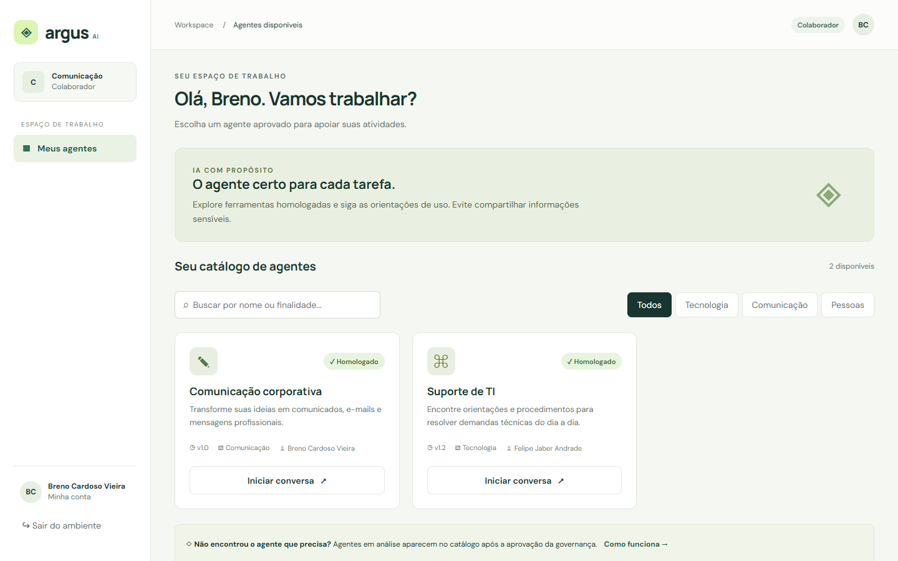
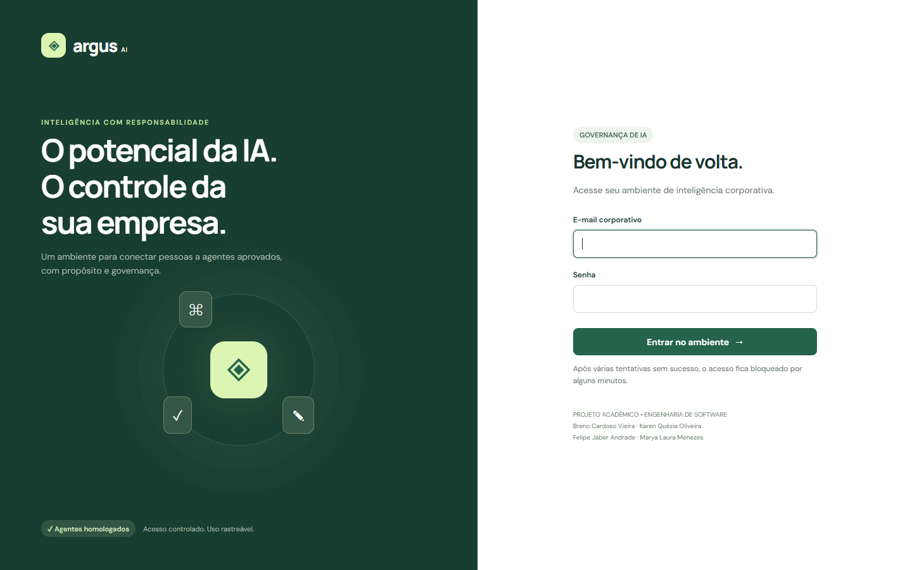
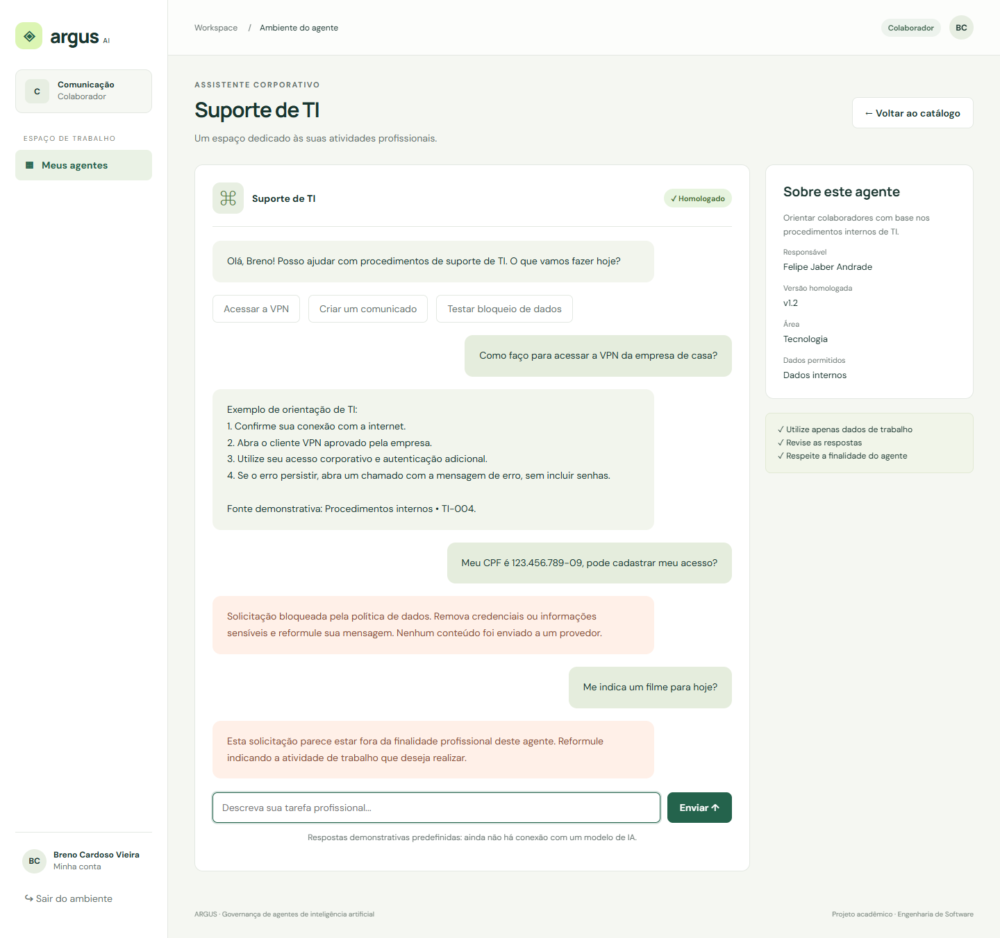
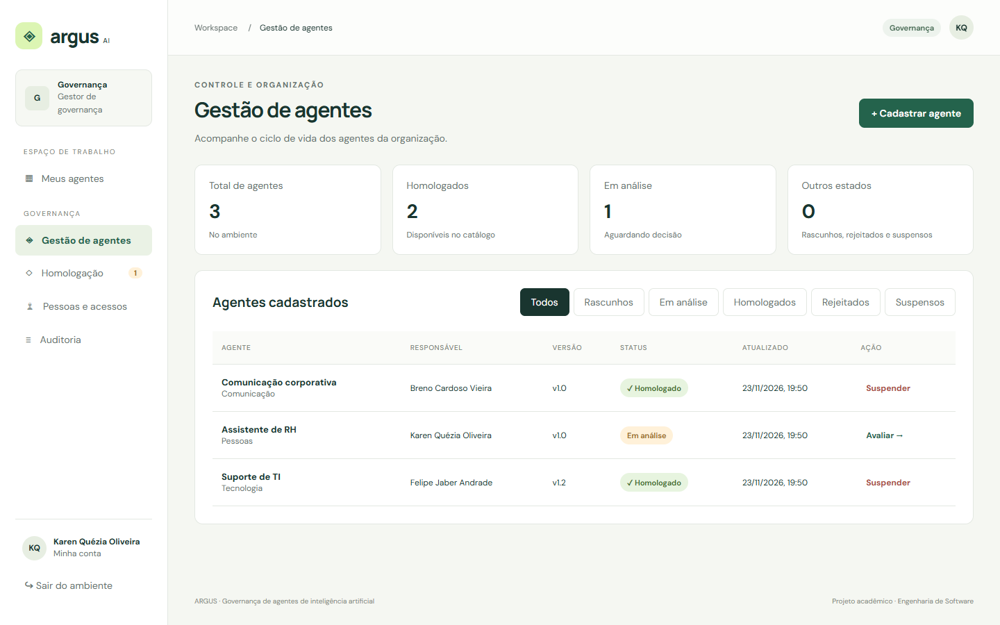
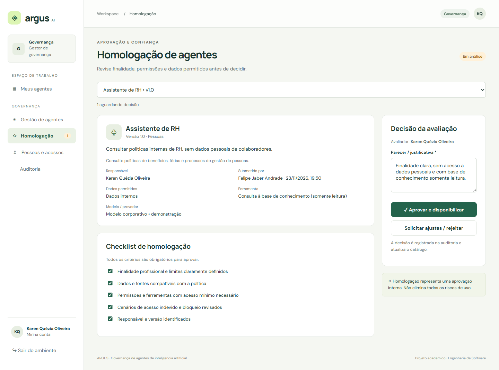
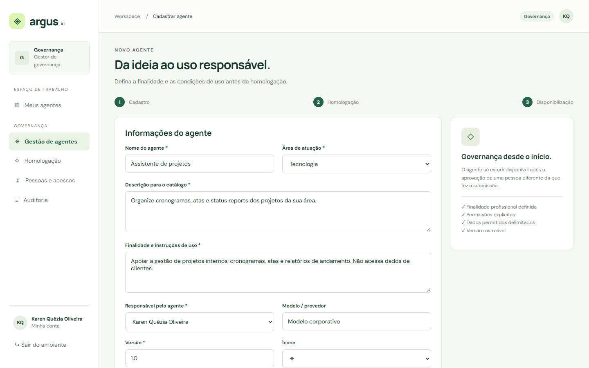
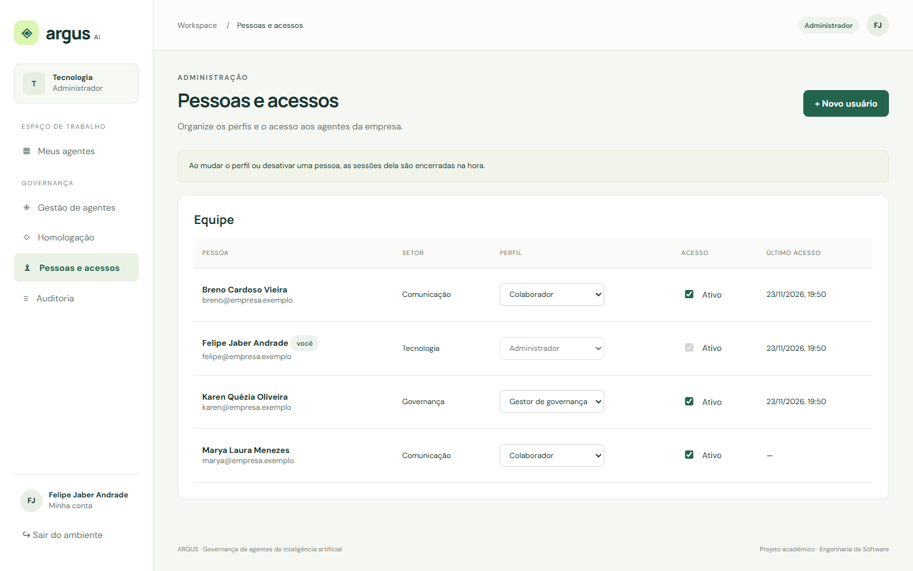
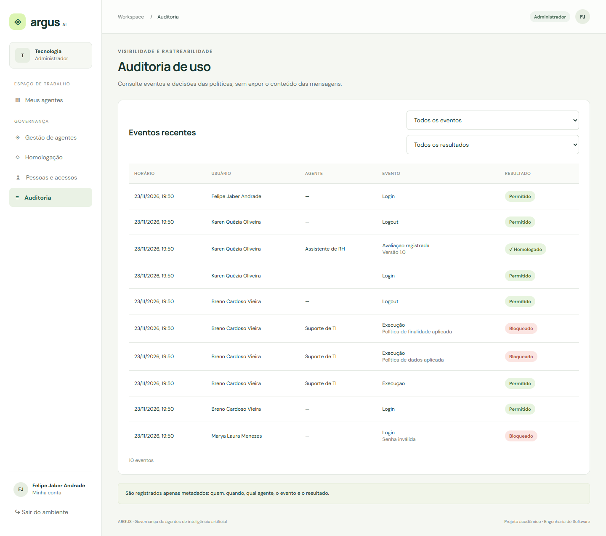
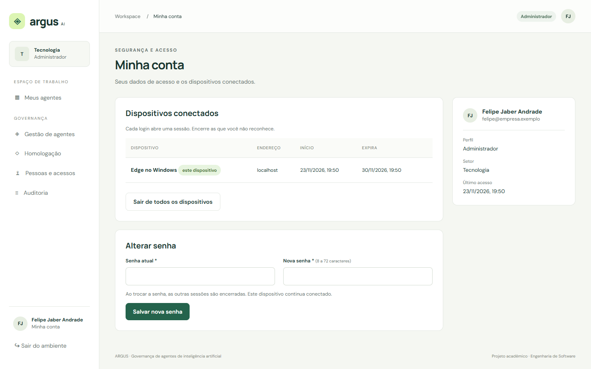

# ◈ argus AI

[](https://github.com/FelipeJaber/argus/actions/workflows/backend-ci.yml)


**Governança de agentes de inteligência artificial.** O potencial da IA, com o controle da sua empresa.

O Argus conecta colaboradores a agentes de IA **aprovados**, com finalidade definida, políticas de uso e
rastreabilidade. Projeto de TCC de Engenharia de Software.



| Perfil | O que faz |
|---|---|
| **Colaborador** | Encontra agentes homologados no catálogo e os utiliza |
| **Gestor de governança** | Cadastra, avalia e homologa agentes; acompanha a auditoria |
| **Administrador de TI** | Gerencia usuários, perfis e acessos |

## Rodar agora

Só precisa do **JDK 25** (sem Maven, sem Docker, sem banco instalado). A primeira execução baixa as
dependências; depois sobe em cerca de 15 s.

```bash
git clone https://github.com/FelipeJaber/argus.git
cd argus/backend
./mvnw spring-boot:run          # Windows (PowerShell): .\mvnw.cmd spring-boot:run
```

Abra **http://localhost:8080** e entre com `karen@empresa.exemplo` / `Argus@2026` (outros usuários em
[Como rodar](#como-rodar)). O roteiro da apresentação está em [`docs/roteiro-demo.md`](docs/roteiro-demo.md).

## Telas

Capturas do sistema rodando com os dados de demonstração (geradas por
[`docs/telas/capturar-telas.mjs`](docs/telas/capturar-telas.mjs)).

<table>
  <tr>
    <td width="50%" valign="top">
      
      <p><b>Login</b>: access token em memória e refresh token em cookie HttpOnly; a sessão volta sozinha ao recarregar.</p>
    </td>
    <td width="50%" valign="top">
      
      <p><b>Ambiente do agente</b>: pedido profissional respondido; CPF bloqueado pela política de dados e pedido fora da finalidade bloqueado, antes de chegar ao provedor.</p>
    </td>
  </tr>
  <tr>
    <td valign="top">
      
      <p><b>Gestão de agentes</b>: indicadores e ciclo de vida (rascunho, em análise, homologado, rejeitado, suspenso).</p>
    </td>
    <td valign="top">
      
      <p><b>Homologação</b>: aprovar exige checklist completo e justificativa; quem submeteu não pode aprovar.</p>
    </td>
  </tr>
  <tr>
    <td valign="top">
      
      <p><b>Cadastro de agente</b>: finalidade, responsável, versão, dados permitidos e ferramentas.</p>
    </td>
    <td valign="top">
      
      <p><b>Pessoas e acessos</b>: o administrador muda perfis e desativa contas; as sessões da pessoa caem na hora.</p>
    </td>
  </tr>
  <tr>
    <td valign="top">
      
      <p><b>Auditoria</b>: logins, senha inválida, bloqueios de política e homologações, sem guardar o texto das mensagens.</p>
    </td>
    <td valign="top">
      
      <p><b>Minha conta</b>: dispositivos conectados, sair de todos e troca de senha.</p>
    </td>
  </tr>
</table>

## Repositório

```
.
├── backend/                 API REST — Java 25 + Spring Boot 4.2
│   ├── src/main/java/br/com/argus/
│   ├── src/main/resources/static/         frontend web (HTML, CSS e JS puros)
│   ├── src/main/resources/db/migration/   migrações Flyway
│   └── http/argus.http      requisições de exemplo
├── docs/
│   ├── arquitetura.md       arquitetura, fluxo de segurança e decisões
│   ├── roteiro-demo.md      roteiro para apresentar o MVP
│   ├── telas/               capturas das telas + script que as gera
│   ├── prototipo/           protótipo navegável (HTML)
│   └── identidade/          identidade visual da marca (PPTX)
├── docker-compose.yml       PostgreSQL local
└── .github/workflows/       CI (build + testes)
```

## Stack

- **Java 25** e **Spring Boot 4.2** (Web MVC, Security, Data JPA, Validation, Actuator)
- **Spring Security OAuth2 Resource Server**: access token JWT (HS256) + refresh token rotativo em cookie HttpOnly
- **PostgreSQL** em produção; **H2** (modo PostgreSQL) em desenvolvimento e testes
- **Flyway** para versionar o schema
- **springdoc-openapi**: Swagger UI
- **Frontend**: HTML, CSS e JavaScript puros (ES modules, sem build), servido pelo próprio Spring Boot
- **JUnit 5 + MockMvc**: 51 testes (unitários e de integração com a cadeia de segurança real)

## Como rodar

Pré-requisito: **JDK 25**. Maven não é necessário (o projeto usa o Maven Wrapper).
**Docker não é necessário** para rodar nem para testar: o padrão é um banco H2 embutido.

### Sem Docker, com H2 em memória (recomendado para apresentação)

```bash
cd backend
./mvnw spring-boot:run          # Windows (PowerShell): .\mvnw.cmd spring-boot:run
# ou, com o jar já empacotado:  java -jar target/argus-api-0.1.0-SNAPSHOT.jar
```

Sobe em `http://localhost:8080` com H2 em memória e os dados fictícios do protótipo. Não precisa de variável de
ambiente nem de perfil: banco, chave JWT e senha de demonstração estão fixos em
[`application.properties`](backend/src/main/resources/application.properties).

- **Aplicação web: http://localhost:8080** (entre com um dos usuários abaixo)
- Swagger UI: http://localhost:8080/swagger-ui.html (faça login e use o botão **Authorize** com o `accessToken`)
- Health: http://localhost:8080/actuator/health
- Console do banco H2: http://localhost:8080/h2-console (JDBC URL `jdbc:h2:mem:argus`, usuário `sa`, senha vazia;
  só a partir do próprio computador; desligado no perfil `prod`)

Usuários de demonstração (senha `Argus@2026`):

| E-mail | Perfil |
|---|---|
| `breno@empresa.exemplo` | Colaborador |
| `marya@empresa.exemplo` | Colaborador |
| `karen@empresa.exemplo` | Gestora de governança |
| `felipe@empresa.exemplo` | Administrador |

> Dados e chaves fictícios, só para desenvolvimento e demonstração (o perfil `prod` não cria esses dados nem usa
> essas chaves). O banco é em memória: reiniciar volta ao estado inicial.
>
> Roteiro passo a passo para apresentar o sistema: [`docs/roteiro-demo.md`](docs/roteiro-demo.md).

### Com PostgreSQL (opcional, usa Docker; perfil `prod`)

```bash
docker compose up -d
cd backend
./mvnw -DskipTests package
ARGUS_JWT_SECRET="$(openssl rand -base64 48)" java -jar target/argus-api-0.1.0-SNAPSHOT.jar --spring.profiles.active=prod
```

O perfil `prod` ([`application-prod.properties`](backend/src/main/resources/application-prod.properties)) lê
banco e segredos de variáveis de ambiente, listadas em [`backend/.env.example`](backend/.env.example).
**Nele, sem `ARGUS_JWT_SECRET` a aplicação não sobe.**

### Testes

```bash
cd backend
./mvnw test
```

## Frontend

Telas do protótipo ligadas à API, em `backend/src/main/resources/static/`:

| Tela | Perfil | Endpoints usados |
|---|---|---|
| Login | público | `/auth/login`, `/auth/refresh` (restaura a sessão ao recarregar) |
| Meus agentes (catálogo) | todos | `/agents/catalog` |
| Ambiente do agente (chat) | todos | `/agents/{id}`, `/agents/{id}/messages` |
| Gestão de agentes | gestor | `/agents`, `/agents/stats`, `/submit`, `/suspend` |
| Cadastrar / editar agente | gestor | `POST /agents`, `PUT /agents/{id}`, `/users` (responsável) |
| Homologação | gestor | `/agents?status=IN_REVIEW`, `/review`, `/reviews` |
| Pessoas e acessos | gestor (leitura) · admin (edição) | `/users` |
| Auditoria | gestor | `/audit-events` |
| Minha conta | todos | `/me`, `/me/password`, `/auth/sessions`, `/auth/logout-all` |

Os arquivos do frontend são empacotados junto com a API: depois de alterá-los, reinicie a aplicação.

## API

Todas as rotas ficam em `/api/v1`. Erros seguem a RFC 9457 (`application/problem+json`) com um campo `code`
estável, por exemplo `INVALID_CREDENTIALS`, `SELF_REVIEW_NOT_ALLOWED` ou `CHECKLIST_INCOMPLETE`.

| Método | Rota | Perfil | Descrição |
|---|---|---|---|
| POST | `/auth/login` | público | Access token no corpo + refresh token em cookie |
| POST | `/auth/refresh` | cookie | Rotaciona o refresh token e emite novo access token |
| POST | `/auth/logout` | cookie | Encerra a sessão atual |
| POST | `/auth/logout-all` | autenticado | Encerra todas as sessões do usuário |
| GET / DELETE | `/auth/sessions[/{id}]` | autenticado | Lista ou encerra sessões (dispositivos) |
| GET | `/me` | autenticado | Dados do usuário logado |
| PUT | `/me/password` | autenticado | Troca a senha e encerra as outras sessões |
| GET | `/agents/catalog?category=&q=` | autenticado | Catálogo de agentes homologados |
| GET | `/agents/{id}` | autenticado | Detalhe (colaborador vê só homologados) |
| POST | `/agents/{id}/messages` | autenticado | Usa o agente (passa pelas políticas de uso) |
| GET | `/agents?status=` · `/agents/stats` | gestor | Gestão e indicadores |
| POST / PUT | `/agents` · `/agents/{id}` | gestor | Cadastra/edita (`submitForReview` envia para homologação) |
| POST | `/agents/{id}/submit` · `/review` · `/suspend` | gestor | Ciclo de vida e homologação |
| GET | `/agents/{id}/reviews` | gestor | Histórico de pareceres |
| GET | `/audit-events?outcome=&action=&agentId=` | gestor | Auditoria |
| GET | `/users` | gestor | Pessoas e acessos |
| POST / PATCH | `/users` · `/users/{id}` | admin | Cria usuário, altera perfil, setor ou status |

Exemplos prontos em [`backend/http/argus.http`](backend/http/argus.http).

## Segurança (resumo)

- **Access token** JWT de 15 min, ligado a uma **sessão** no banco pelo claim `sid`. Logout, troca de senha,
  mudança de perfil e desativação valem **na hora**.
- **Refresh token** opaco em cookie `HttpOnly` + `SameSite=Strict`, armazenado como hash, com **rotação** a
  cada uso e **detecção de reuso**: um token antigo reapresentado revoga a sessão inteira.
- Bloqueio temporário após tentativas de login sem sucesso, BCrypt, hierarquia de perfis e
  **segregação de funções** na homologação.

Detalhes, diagramas e decisões em [`docs/arquitetura.md`](docs/arquitetura.md).

## Glossário (protótipo → código)

| Protótipo | API |
|---|---|
| Rascunho / Em análise / Homologado / Rejeitado / Suspenso | `DRAFT` / `IN_REVIEW` / `APPROVED` / `REJECTED` / `SUSPENDED` |
| Colaborador / Gestor / Administrador | `COLLABORATOR` / `MANAGER` / `ADMIN` |
| Tecnologia / Comunicação / Pessoas | `TECHNOLOGY` / `COMMUNICATION` / `PEOPLE` |
| Permitido / Bloqueado (auditoria) | `ALLOWED` / `BLOCKED` |
| Homologação | `POST /agents/{id}/review` |

## Próximos passos

- [x] Frontend web com a identidade visual de `docs/identidade`
- [ ] Integrar um provedor de IA real (nova implementação de `AgentGateway`)
- [ ] Versão vetorial do símbolo da marca (hoje é o caractere Unicode ◈)
- [ ] Limite de requisições por IP no login
- [ ] Testes de integração contra PostgreSQL (Testcontainers) e `Dockerfile` da API

## Equipe

Breno Cardoso Vieira · Karen Quézia Oliveira · Felipe Jaber Andrade · Marya Laura Menezes
