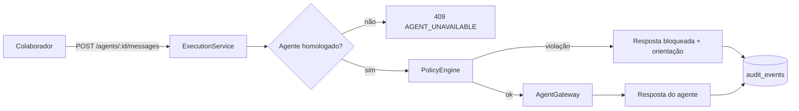
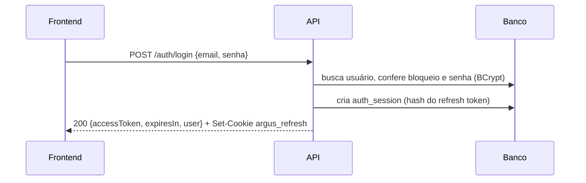

# Arquitetura do backend

## Visão geral

Monólito modular em Spring Boot, organizado **por funcionalidade** (não por camada técnica). Cada pacote
reúne entidade, repositório, serviço, controller e DTOs do seu assunto. Isso mantém o projeto simples de
navegar e permite extrair um módulo no futuro sem reescrever o resto.

```
br.com.argus
├── auth/        login, refresh, logout, sessões (AuthSession) e cookie do refresh token
├── security/    configuração do Spring Security, emissão/validação do JWT, tratamento 401/403
├── user/        usuários, perfis (Role) e "pessoas e acessos"
├── agent/       agentes, ciclo de vida, homologação (AgentReview) e catálogo
├── execution/   uso de agentes: políticas (policy/) e porta para o provedor de IA (gateway/)
├── audit/       trilha de auditoria (somente metadados)
├── shared/      exceções (RFC 9457), paginação, entidade base
└── config/      relógio, OpenAPI e dados de demonstração (argus.seed.enabled)
```

### Frontend

HTML, CSS e JavaScript puros em `src/main/resources/static/`, servidos pelo próprio Spring Boot (mesma
origem da API, então não há CORS nem configuração extra de cookies).

```
static/
├── index.html            shell + Content-Security-Policy (só scripts e estilos deste servidor)
└── assets/
    ├── css/argus.css     identidade visual (paleta, Manrope/DM Sans) sobre o layout do protótipo
    └── js/
        ├── app.js        restaura a sessão, desenha o menu por perfil e roteia por hash (#/catalog...)
        ├── api.js        fetch com access token em memória e renovação automática no 401
        ├── ui.js         escape de HTML, rótulos dos enums, toast, diálogos, erros de formulário
        └── views/        uma tela por arquivo (login, catálogo, chat, gestão, cadastro, homologação...)
```

- **Token só em memória:** recarregar a página chama `POST /auth/refresh`, que usa o cookie HttpOnly.
  Nada de autenticação fica em `localStorage`.
- **Renovação transparente:** um 401 dispara uma única renovação (compartilhada entre chamadas
  simultâneas) e a chamada original é repetida. Se a renovação falhar, o usuário volta ao login.
- **XSS:** todo dado da API passa por `esc()` antes de virar HTML. Não há `onclick` inline, o que
  permite a CSP `script-src 'self'`.
- **Perfis:** o menu e as rotas seguem a mesma hierarquia do backend, mas a autorização de verdade
  continua na API (`@PreAuthorize`). Esconder um botão é só conveniência de interface.

Regras de negócio ficam **nas entidades** (`Agent.approve`, `AuthSession.rotate`, `User.registerFailedLogin`).
Os serviços orquestram transação, repositórios e auditoria. Os controllers só fazem HTTP.

### Fluxo de uso de um agente



`AgentGateway` hoje é a `DemoAgentGateway` (respostas fixas, como no protótipo). Para integrar um modelo
real basta criar outra implementação. Novas políticas são novos `@Component` que implementam `UsagePolicy`.

## Segurança: access token + sessão + refresh token

| Elemento | Onde fica | Validade | Para quê |
|---|---|---|---|
| **Access token** (JWT HS256) | Memória do frontend; enviado em `Authorization: Bearer` | 15 min | Autenticar cada requisição |
| **Sessão** (`auth_sessions`) | Banco | 7 dias deslizantes, máx. 30 dias | Fonte da verdade: permite revogar |
| **Refresh token** (opaco) | Cookie `HttpOnly; SameSite=Strict; Path=/api/v1/auth` | Igual à sessão | Obter novo access token |

Claims do access token: `sub` (usuário), `sid` (sessão), `role`, `name`, `iss`, `iat`, `exp`, `jti`.

**Por que o JWT consulta a sessão?** Um JWT puro não pode ser revogado antes de expirar. O
`ActiveSessionValidator` verifica, a cada requisição, se a sessão do claim `sid` continua ativa (consulta
por chave primária). Assim, logout, troca de senha, mudança de perfil e desativação de usuário têm efeito
**imediato**.

**Por que o refresh token fica em cookie?** `HttpOnly` impede que JavaScript (e, portanto, um XSS) o leia.
`SameSite=Strict` e o `Path` restrito impedem que outros sites o enviem (CSRF). O access token vai no corpo
da resposta e deve ficar só em memória no frontend.

**Formato do refresh token:** `<id-da-sessão>.<segredo aleatório de 256 bits>`. O banco guarda apenas o
SHA-256 do segredo. Comparações usam tempo constante.

### Login



### Refresh com rotação e detecção de reuso

```mermaid
sequenceDiagram
    participant F as Frontend
    participant A as API
    participant DB as Banco
    F->>A: POST /auth/refresh (cookie com token T1)
    A->>DB: carrega sessão pelo id contido em T1
    alt T1 é o token atual
        A->>DB: rotação: anterior = T1, atual = T2, estende validade
        A-->>F: 200 {novo accessToken} + Set-Cookie T2
    else T1 é o anterior e a rotação foi há menos de 10 s
        A-->>F: 409 REFRESH_TOKEN_ROTATED (corrida entre abas; o cookie já tem T2)
    else T1 é antigo (possível roubo)
        A->>DB: revoga a sessão inteira + auditoria REFRESH_TOKEN_REUSE
        A-->>F: 401 INVALID_REFRESH_TOKEN
    end
```

### Outras proteções

- **Força bruta:** 5 senhas erradas bloqueiam a conta por 15 min (`429 ACCOUNT_LOCKED`).
- **Enumeração de contas:** e-mail inexistente e senha errada devolvem o mesmo erro, e um hash fictício é
  verificado para igualar o tempo de resposta.
- **Senhas:** BCrypt via `DelegatingPasswordEncoder` (prefixo `{bcrypt}` permite migrar o algoritmo).
- **Autorização:** `@PreAuthorize` por endpoint, com hierarquia `ADMIN > MANAGER > COLLABORATOR`.
- **Segregação de funções:** quem submete um agente não pode homologá-lo (regra na entidade `Agent`).
- **Concorrência:** `@Version` (lock otimista) em usuários, agentes e sessões → `409 CONCURRENT_MODIFICATION`.
- **Erros:** respostas RFC 9457 (`application/problem+json`) com campo `code` estável para o frontend.
- **Privacidade:** a auditoria nunca grava o texto das mensagens enviadas aos agentes.
- **Segredo JWT:** no perfil `prod` a aplicação não sobe sem `ARGUS_JWT_SECRET` com 32 bytes ou mais. A chave fixa do `application.properties` é só de desenvolvimento (o repositório é público).

## Decisões e alternativas

| Decisão | Alternativa considerada | Motivo |
|---|---|---|
| JWT curto + sessão no banco | JWT puro (stateless) | Revogação imediata, essencial para governança. Custo: 1 consulta por PK a cada requisição |
| HS256 com segredo compartilhado | RS256 (par de chaves) | Só a própria API emite e valida tokens. Trocar para RS256 é mudar 2 beans em `SecurityConfig` |
| Spring OAuth2 Resource Server (Nimbus) | Biblioteca JJWT + filtro próprio | Menos código próprio de segurança e validação padrão de `exp`/`iss`/assinatura |
| Monólito modular por funcionalidade | Camadas (controller/service/repository) | Coesão por assunto e projeto fácil de navegar |
| H2 por padrão (desenvolvimento) e nos testes | Testcontainers | Roda sem Docker. O SQL das migrações é compatível com PostgreSQL e H2 |
| Flyway + `ddl-auto: validate` | `ddl-auto: update` | Schema versionado e revisável. O Hibernate só valida o mapeamento |
